# PersonaAI: Project Demo Walkthrough

**An adaptive AI study assistant that learns what you don't know yet.**
Aligned with **SDG 4: Quality Education**.

This walkthrough follows one student, **Vivek**, from first sign-in to a personalised exam plan. Every screenshot was taken from the running application, using the real *Big Data Analytics* unit notes (Unit III and Unit IV PDFs). Read top to bottom; each screenshot has an explanation of what is on screen and what the system is doing behind it.

---

## Contents

1. [The problem and the idea](#1-the-problem-and-the-idea)
2. [Signing in](#2-signing-in)
3. [Feature 1: Notes Q&A with citations](#3-feature-1-notes-qa-with-citations)
4. [Feature 2: Quiz generation](#4-feature-2-quiz-generation)
5. [Feature 3: Weak-topic memory and Progress dashboard](#5-feature-3-weak-topic-memory-and-progress-dashboard)
6. [Feature 4: Personalised study plan](#6-feature-4-personalised-study-plan)
7. [The adaptive loop in action](#7-the-adaptive-loop-in-action)
8. [System check](#8-system-check)
9. [Evaluation results](#9-evaluation-results)
10. [Architecture and tech stack](#10-architecture-and-tech-stack)
11. [Known limitations and future work](#11-known-limitations-and-future-work)

---

## 1. The problem and the idea

Students revise from scattered PDFs and notes. General AI chatbots:

- answer from general internet knowledge, not from **the student's own syllabus**;
- don't remember **what the student got wrong last time**;
- give **the same generic study advice** to everyone.

**PersonaAI** grounds every answer in the student's uploaded notes (Retrieval-Augmented Generation, RAG) and keeps a long-term memory of each student's weak topics. That memory then drives two things: which quiz questions to ask next, and how to split time in the exam study plan.

**The demo story in one line:** Vivek uploads his notes → asks questions → takes quizzes → PersonaAI discovers he is weak in *Pig Data Types* and *Sqoop Imports* → it targets those topics in quizzes and the study plan → his scores rise from 60% to 100%, and the plan adjusts automatically.

---

## 2. Signing in

### 01. Sign-in screen

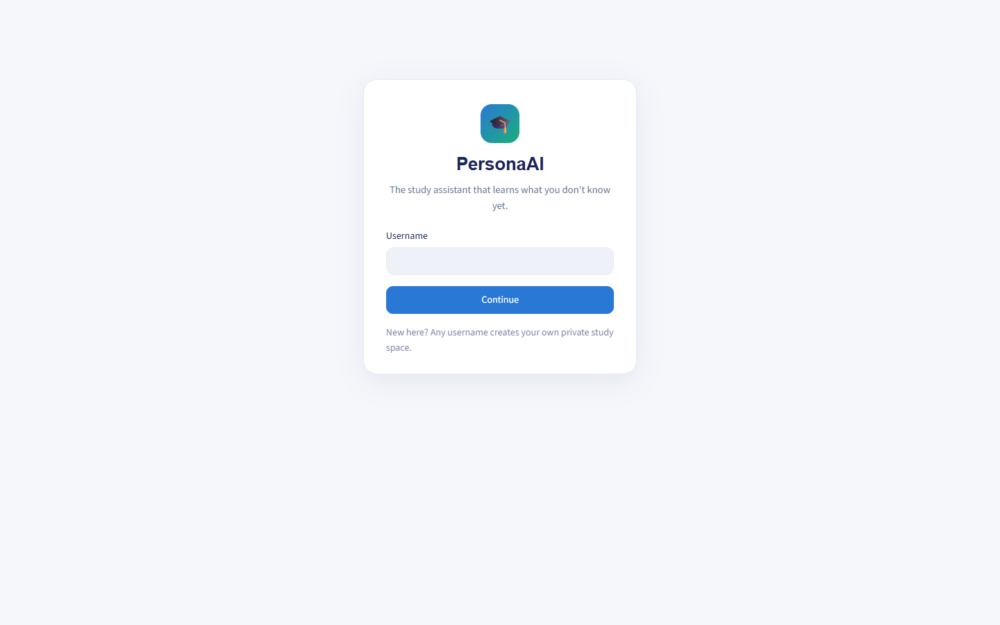

The entry point of the app. The student types a username and clicks **Continue**. Any new username creates a private study space, and an existing one reopens it. Each user's documents, quiz history, weak topics and plans are stored separately in the SQLite database, so two students never see each other's data.

> Note for the mentor: this is identification, not authentication (there is no password). That is acceptable for a single-user or classroom prototype, and is listed under future work.

### 02. Home dashboard for a new user

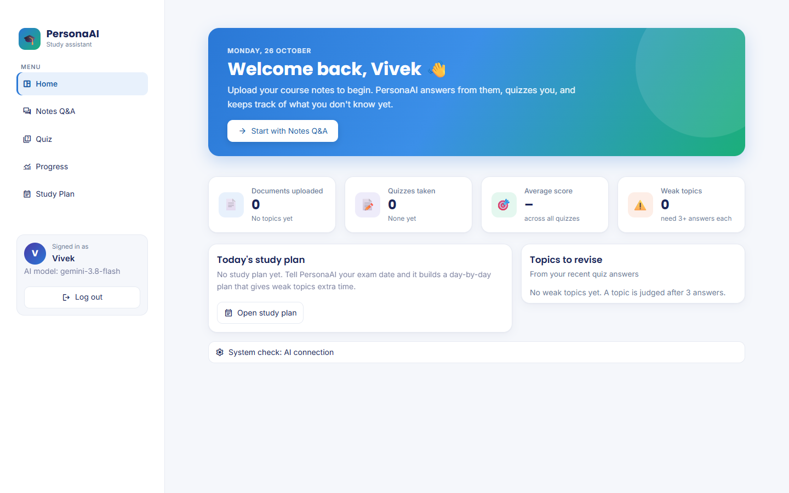

After sign-in, the **Home** dashboard opens. The left sidebar is the main navigation, with five pages: *Home, Notes Q&A, Quiz, Progress, Study Plan*. The signed-in user and the **active AI model** are shown at the bottom.

Because Vivek is new, everything is empty:

- The welcome banner tells him what to do first and offers a **Start with Notes Q&A** button.
- Four stat cards show *Documents uploaded, Quizzes taken, Average score, Weak topics*, all zero.
- *Today's study plan* and *Topics to revise* explain what will appear once he has used the app.

The dashboard is **context-aware**: the banner message and its button change with the student's state (no notes → upload; weak topics found → take an adaptive quiz). Screenshot 22 shows the change.

---

## 3. Feature 1: Notes Q&A with citations

### 03. Notes Q&A page, before any upload

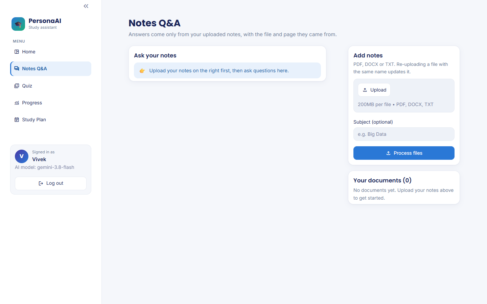

The Q&A page has two panels:

- **Left: "Ask your notes"**, the chat area. It is disabled with a hint until notes are uploaded.
- **Right: "Add notes"**, the upload area. It accepts **PDF, DOCX and TXT**, with an optional subject label. Re-uploading a file with the same name updates it instead of duplicating it.

### 04. Choosing the course files

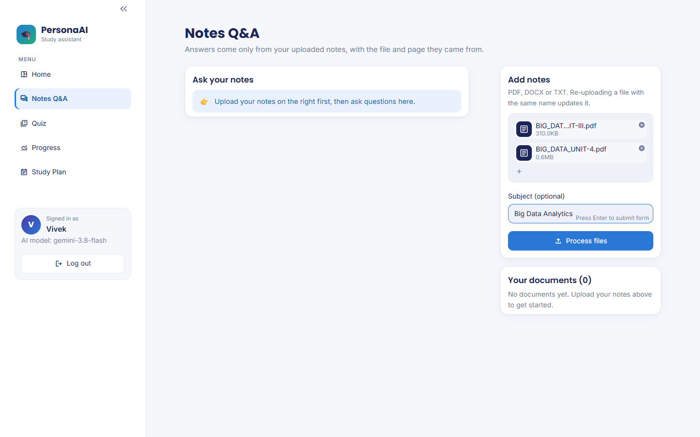

Vivek selects his two Big Data unit PDFs (`BIG_DATA_UNIT-III.pdf`, `BIG_DATA_UNIT-4.pdf`) and tags them with the subject **Big Data Analytics**.

### 05. Processing the documents

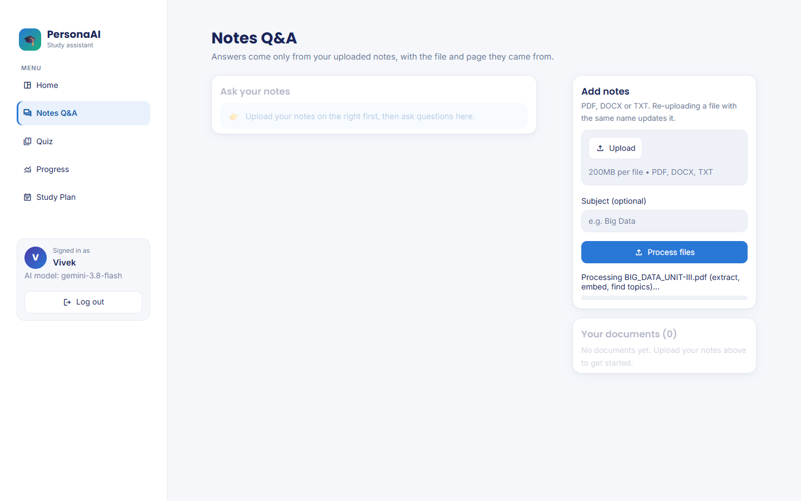

After **Process files** is clicked, a progress bar shows each file going through the ingestion pipeline:

1. **Extract** the text page by page (pypdf for PDF, python-docx for Word), keeping page numbers for citations.
2. **Chunk** the text into small passages.
3. **Embed** each chunk into a vector with the local `all-MiniLM-L6-v2` sentence-transformer model and store it in the **ChromaDB** vector database.
4. **Find topics:** the LLM reads the document and extracts its syllabus topics. These topics are the units that quizzes, weak-topic memory and the study plan all work with.

### 06. Upload complete

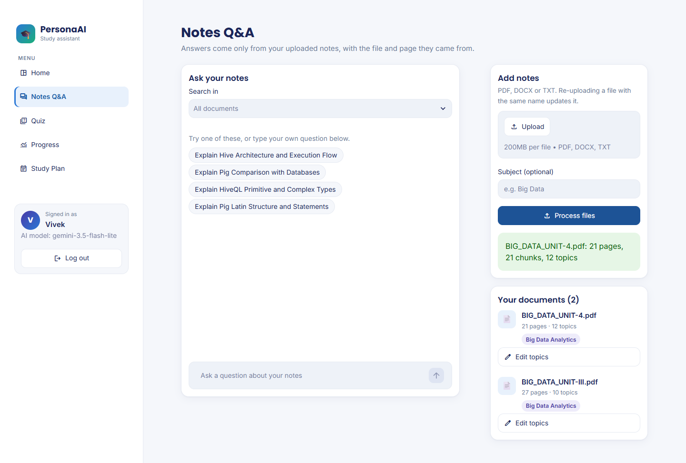

A success message reports what was found (here: *21 pages, 21 chunks, 12 topics* for Unit 4). The **Your documents** list now shows both PDFs with page count, number of topics and the subject tag. The chat panel is now active and offers **suggested questions** built from the extracted topics.

In total the two PDFs produced **48 pages and 22 topics** (Pig, Flume, Hive and Sqoop).

### 07. Reviewing and editing the extracted topics

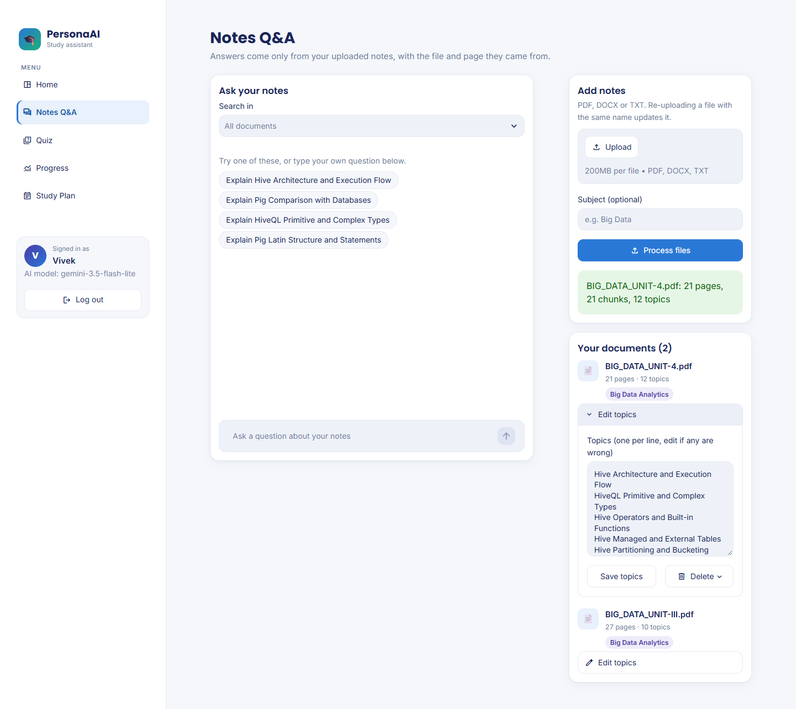

AI topic extraction is not perfect, so the student stays in control. **Edit topics** opens the topic list for a document (one per line). The student can rename, add or remove topics and click **Save topics**. **Delete** removes the document, its chunks and its topics.

### 08. Asking a question (suggested question)

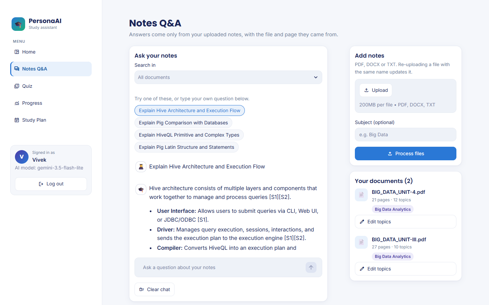

Vivek clicks the suggestion **"Explain Hive Architecture and Execution Flow"**. The answer is structured (interface, driver, compiler, …), and every statement carries a citation marker such as **[S1]** or **[S2]**.

Behind the scenes (the RAG pipeline):

1. The question is embedded and the **20 most similar chunks** are retrieved from ChromaDB.
2. A **cross-encoder reranker** (`ms-marco-MiniLM-L-6-v2`, runs locally) re-scores those 20 and keeps the **best 5**.
3. The LLM receives only those 5 excerpts and is instructed to answer **only from them** and to cite them.

### 09. Citations: file and page for every answer

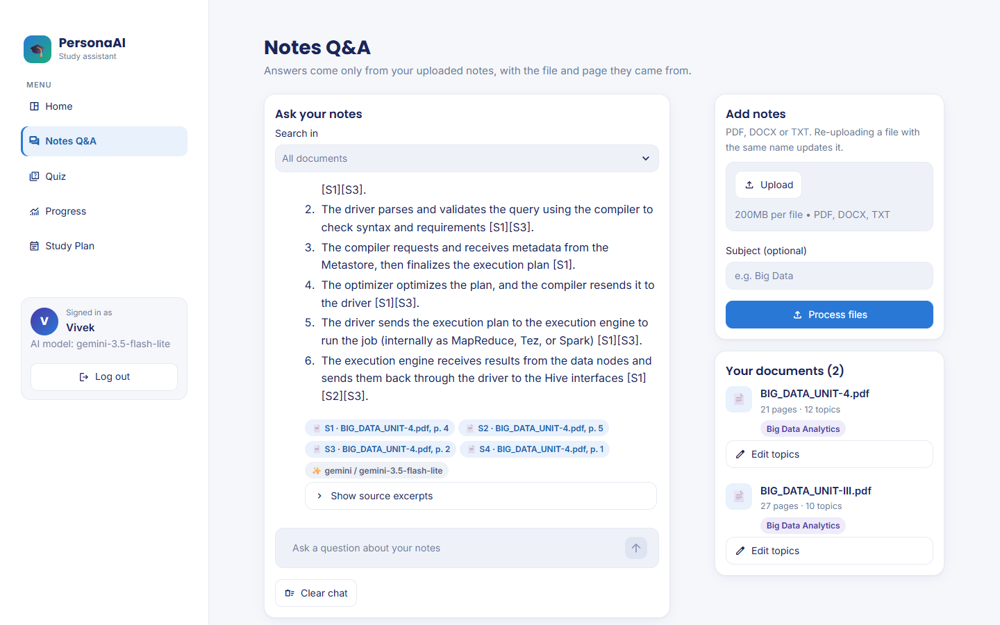

At the end of the answer, each source **S1–S4** is shown as a badge with the **file name and page number** (e.g. *BIG_DATA_UNIT-4.pdf, p. 4*). A second badge shows **which AI model** wrote the answer. The student can open the exact page in their notes to verify the answer, which a normal chatbot cannot offer.

### 10. Source excerpts

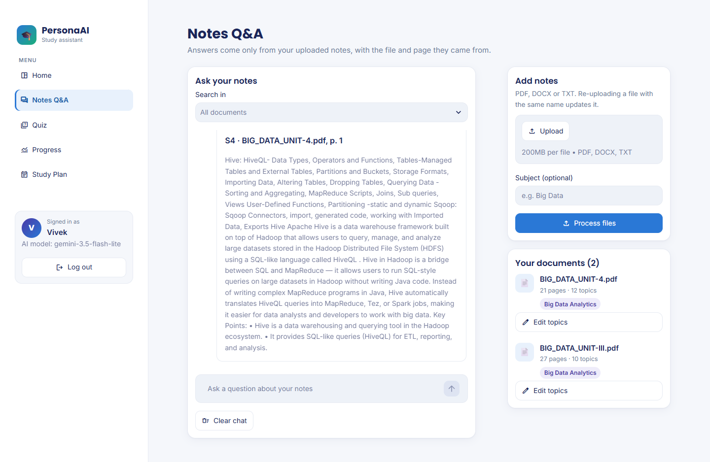

**Show source excerpts** expands the actual text passages the answer was built from. This makes the system transparent: the student (or the mentor) can check that the answer really comes from the notes.

### 11. A typed question

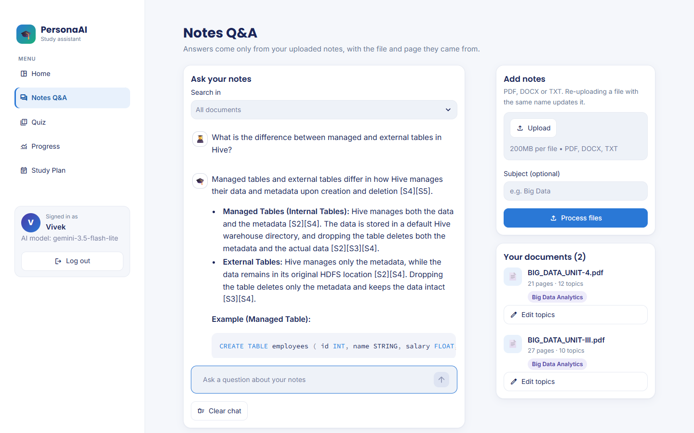

The student can also type any question. Here: *"What is the difference between managed and external tables in Hive?"* The answer contrasts the two table types, adds a code example taken from the notes, and cites the pages (Unit 4, pp. 5, 12, 15, 16).

The **Search in** box above the chat can restrict the search to specific documents.

### 12. A question that is not in the notes

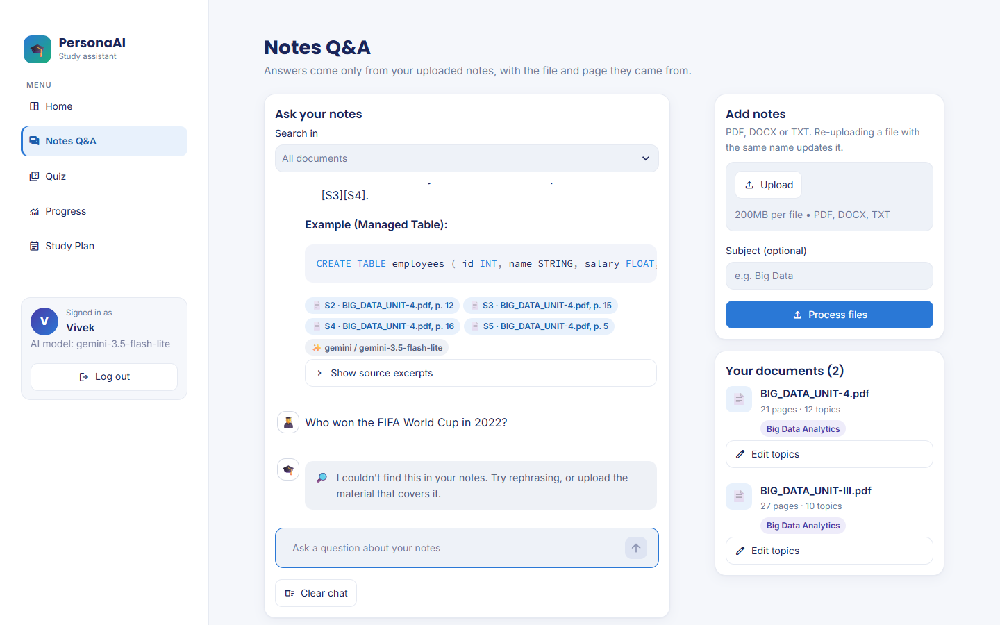

To test the guardrail, Vivek asks something unrelated: *"Who won the FIFA World Cup in 2022?"*

PersonaAI replies: **"I couldn't find this in your notes. Try rephrasing, or upload the material that covers it."**

This is deliberate. A general chatbot would answer from internet knowledge, and in a study tool that risks confident answers that differ from the syllabus. Here the reranker scored every retrieved chunk below the relevance threshold, so **the LLM was not even called** (there is no model badge). That saves cost and prevents hallucination.

---

## 4. Feature 2: Quiz generation

### 13. Quiz setup

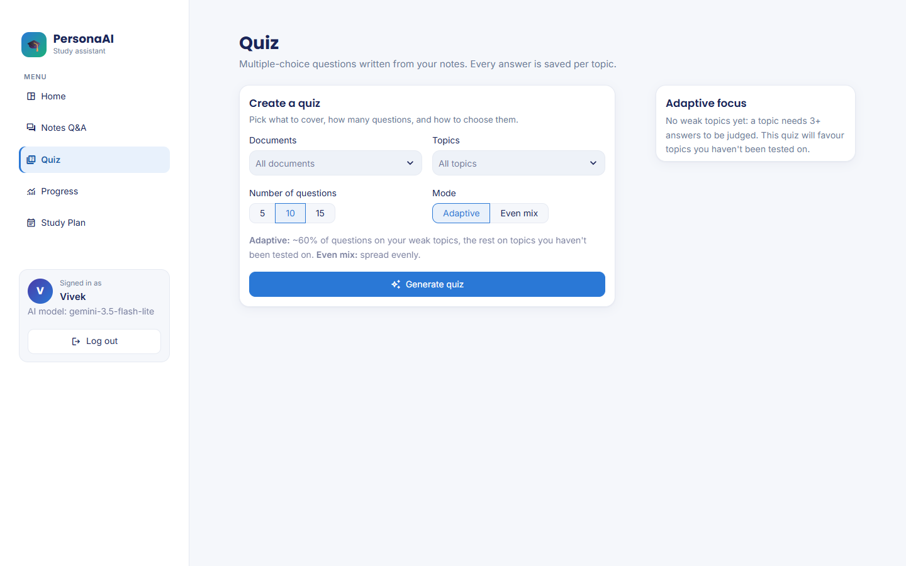

The Quiz page lets the student create a multiple-choice quiz from their notes:

- **Documents / Topics:** what to cover (default: everything).
- **Number of questions:** 5, 10 or 15.
- **Mode:**
  - **Adaptive:** about 60% of questions on the student's weak topics; the rest on topics not tested yet.
  - **Even mix:** questions spread evenly across the chosen topics.

The **Adaptive focus** card on the right shows what an adaptive quiz would target. Right now it says *"No weak topics yet: a topic needs 3+ answers to be judged"*, because PersonaAI does not label a topic weak or strong from one or two answers.

### 14. Configuring the first quiz

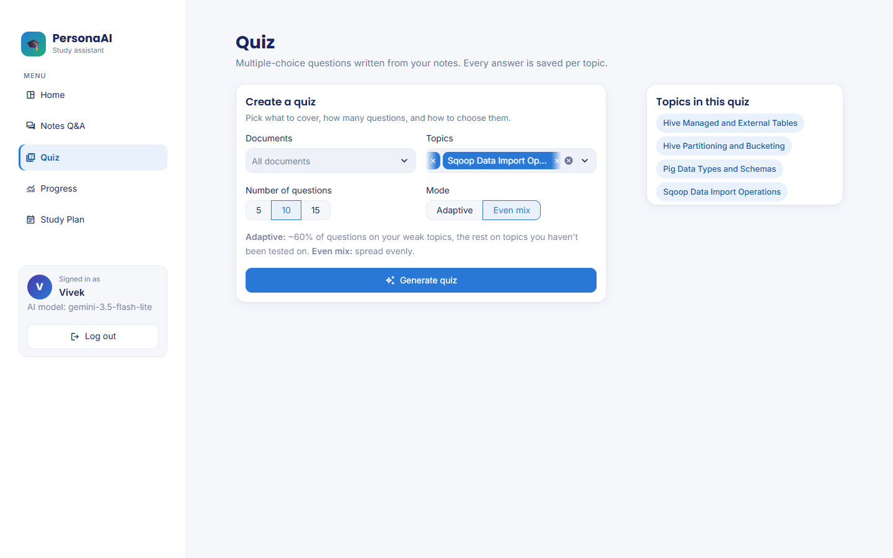

For the demo, Vivek chooses four topics (*Hive Managed and External Tables, Hive Partitioning and Bucketing, Pig Data Types and Schemas, Sqoop Data Import Operations*), **10 questions**, **Even mix**. The right card lists the topics in this quiz.

### 15. Generating questions

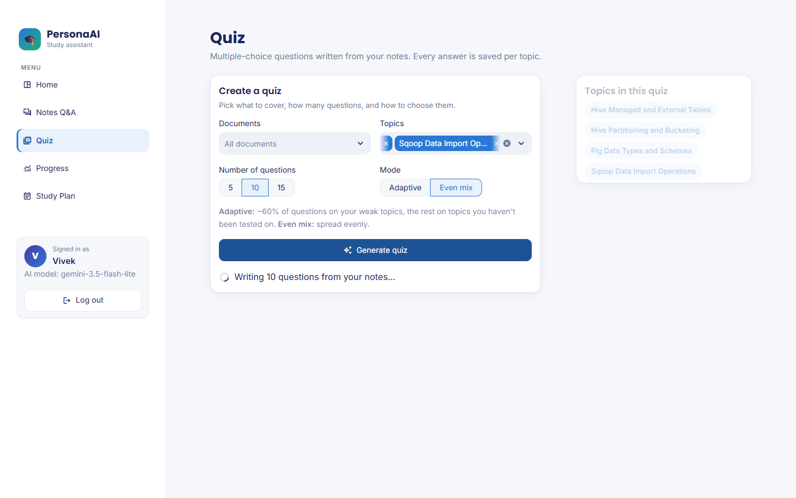

On **Generate quiz**, PersonaAI retrieves note excerpts for each chosen topic and asks the LLM to write exam-style multiple-choice questions, each with 4 options, the correct answer, an explanation and the source page. Malformed or missing questions are retried automatically (up to 3 attempts).

### 16. Answering a question

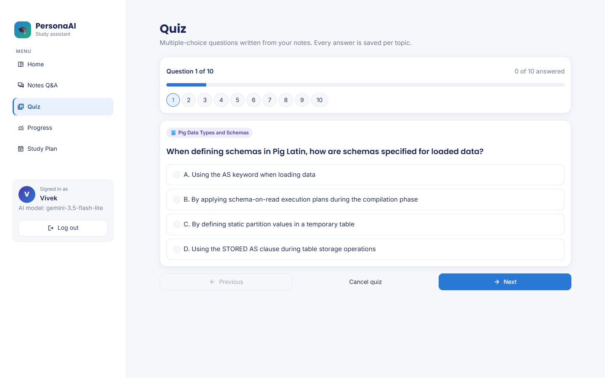

One question at a time. The purple tag shows the **topic** of the question (*Pig Data Types and Schemas*). The progress bar and *"0 of 10 answered"* show progress.

### 17. Question navigator

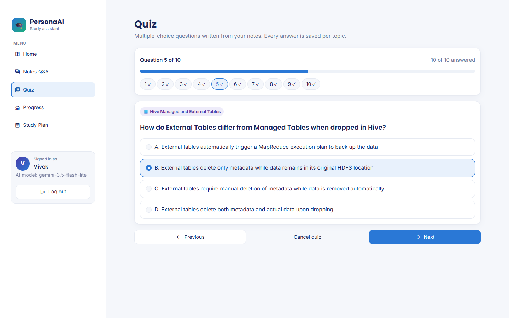

The numbered pills let the student jump to any question; answered ones get a **✓**. **Previous / Next** move one step, and **Cancel quiz** discards the quiz.

### 18. Submitting

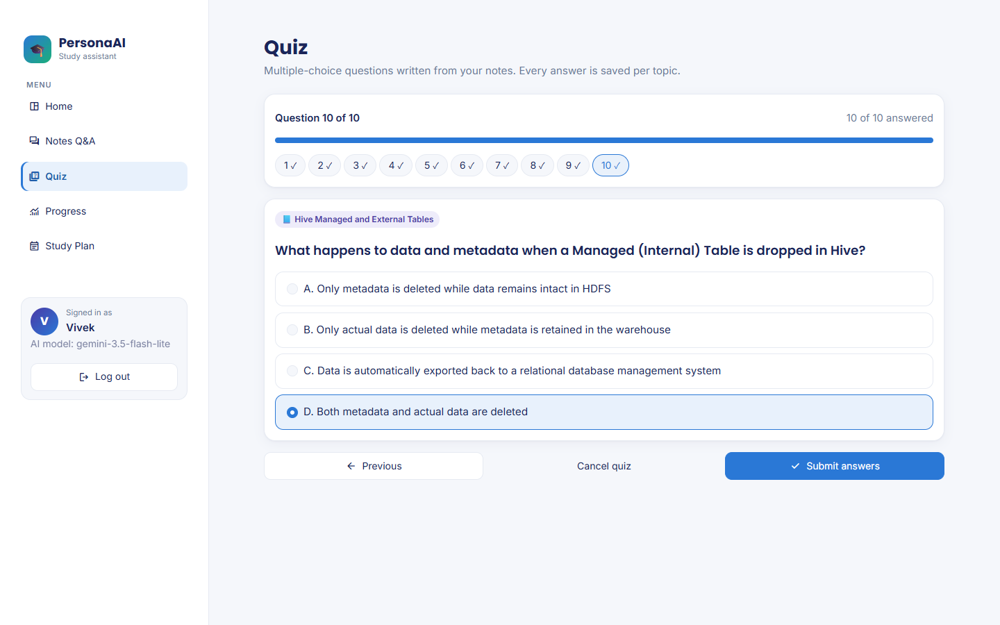

On the last question the **Next** button becomes **Submit answers**. If any question is unanswered, the app lists the missing numbers instead of submitting.

> For the demo, Vivek plays a student who knows **Hive** well but is weak on **Pig** and **Sqoop**, so some answers are deliberately wrong.

### 19. Quiz results

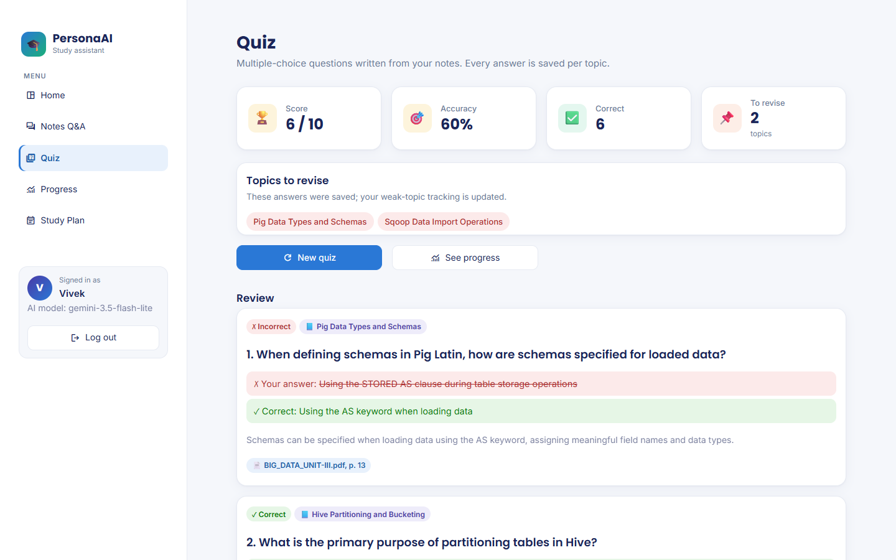

Instant grading: **Score 6/10, accuracy 60%**. **Topics to revise** lists the topics answered wrongly (*Pig Data Types and Schemas, Sqoop Data Import Operations*). The message *"These answers were saved; your weak-topic tracking is updated"* is the key point: **every answer is stored per topic in the database**, and that is what feeds the memory.

### 20. Full answer review

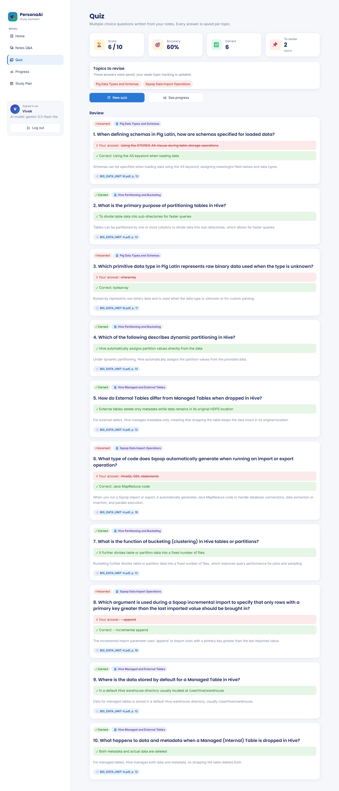

Below the score, every question is reviewed:

- **Correct / Incorrect** badge and topic tag;
- for wrong answers, the student's choice (struck through) and the correct answer;
- a short **explanation**;
- the **source page** in the notes (e.g. *BIG_DATA_UNIT-III.pdf, p. 13*), so the student can go straight to the material to revise.

### 21. A second, short quiz

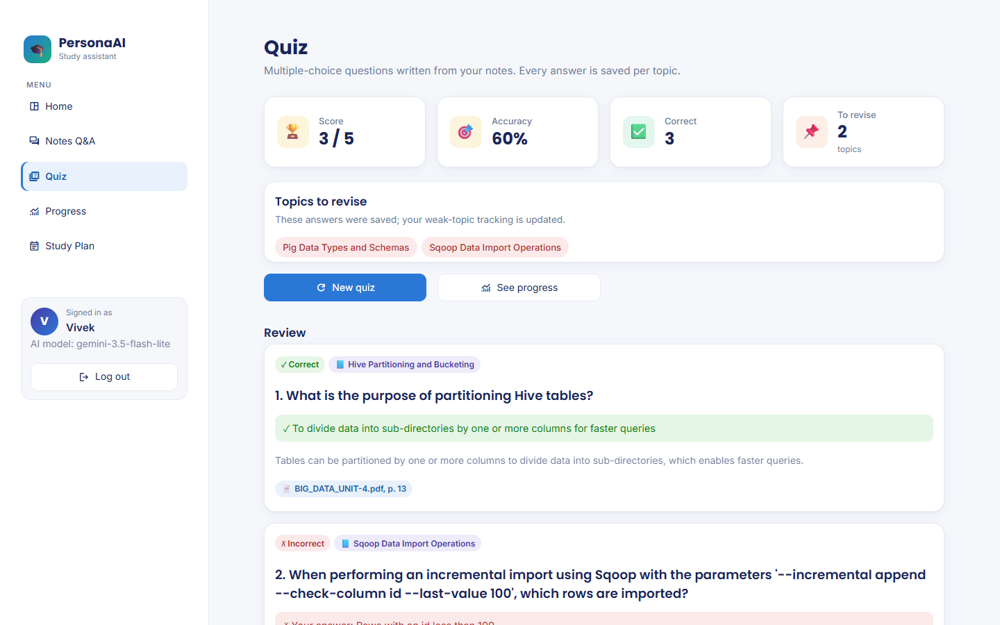

Vivek takes another 5-question quiz (**3/5**, 60%). Pig and Sqoop are wrong again. Each of the four topics now has **3 or more answers**, enough for PersonaAI to judge them.

---

## 5. Feature 3: Weak-topic memory and Progress dashboard

### 22. Home dashboard after two quizzes

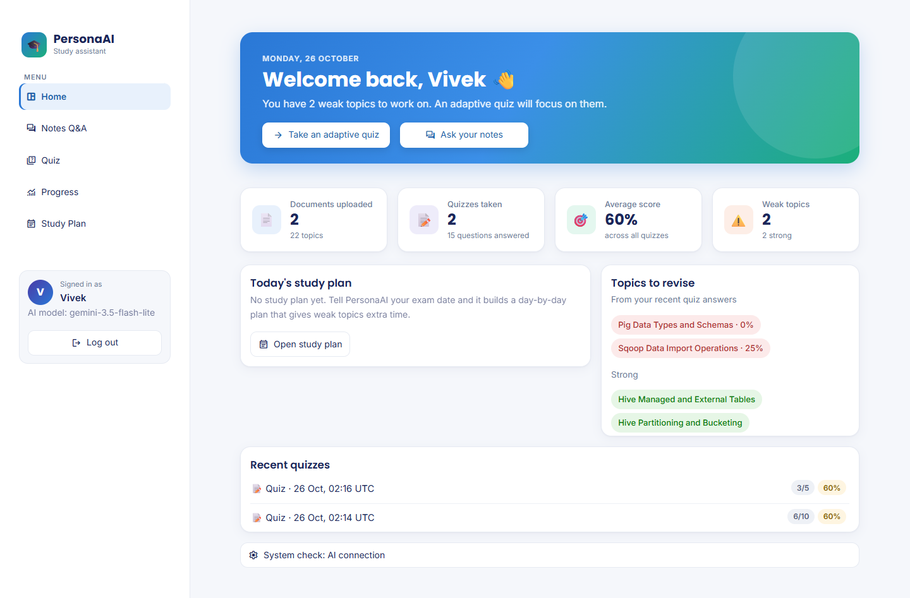

The Home page has updated itself:

- Banner: **"You have 2 weak topics to work on. An adaptive quiz will focus on them."**, with a **Take an adaptive quiz** button.
- Stats: 2 documents, 2 quizzes (15 questions), 60% average, **2 weak topics, 2 strong**.
- **Topics to revise:** *Pig Data Types and Schemas · 0%*, *Sqoop Data Import Operations · 25%* (red).
- **Strong:** *Hive Managed and External Tables*, *Hive Partitioning and Bucketing* (green).
- **Recent quizzes** with score and colour-coded percentage.

### 23. Progress dashboard

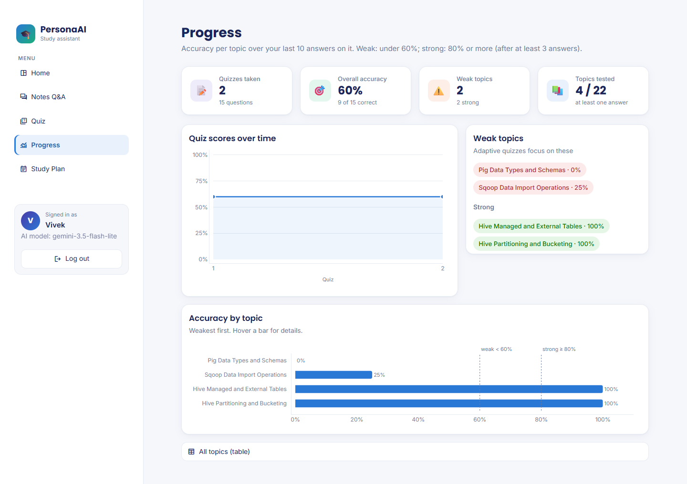

The Progress page explains the rule at the top. Accuracy per topic is measured over the **last 10 answers** on that topic:

| Status | Rule |
|---|---|
| **Weak** | under 60% (after at least 3 answers) |
| **Strong** | 80% or more (after at least 3 answers) |
| **Still learning** | 60–79%, or fewer than 3 answers |

Charts (Plotly):

- **Quiz scores over time:** the score trend across quizzes.
- **Accuracy by topic:** a bar per topic, weakest first, with the 60% and 80% thresholds drawn as dashed lines.

Using only the *recent* answers means a topic can recover: when the student improves, old mistakes drop out of the window.

### 24. All-topics table

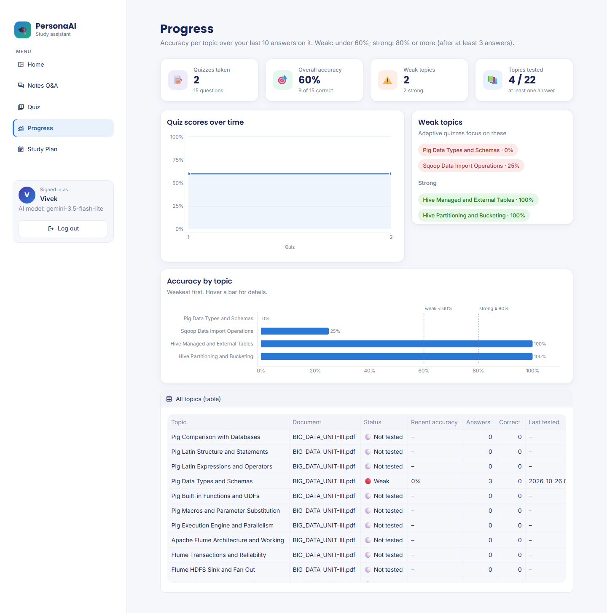

**All topics (table)** lists every topic from every document: document, status, recent accuracy, number of answers, correct answers and last tested date. Here 4 of 22 topics have been tested; the rest are **Not tested**. The Adaptive quiz and the study plan both use this "not tested" status.

---

## 6. Feature 4: Personalised study plan

### 25. Creating a plan

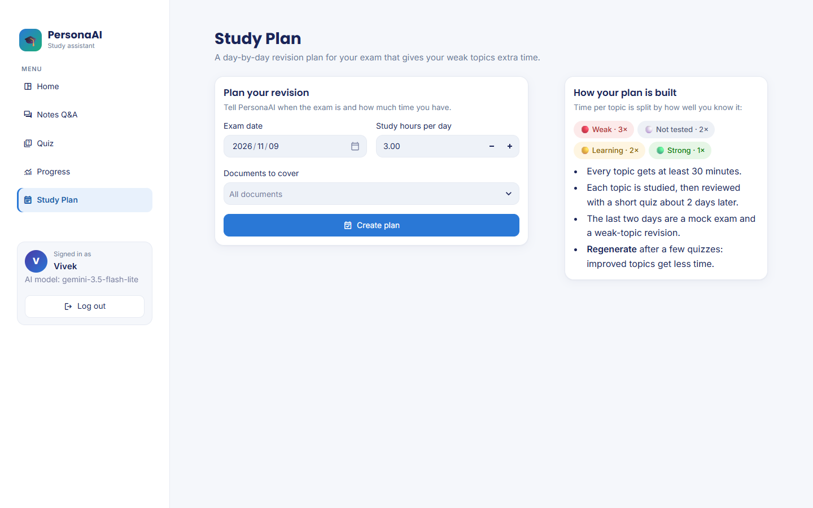

The student enters the **exam date** (here 9 Nov, 14 days away), **study hours per day** (3 h) and, optionally, which documents to cover.

The **How your plan is built** card explains the rules openly:

- Time per topic is weighted by how well the student knows it: **Weak 3×, Not tested 2×, Learning 2×, Strong 1×**.
- Every topic gets at least 30 minutes.
- Each topic is **studied, then reviewed with a short quiz about 2 days later** (spaced review).
- The last two days are a **mock exam** and a **weak-topic final revision**.

### 26. The generated day-by-day plan

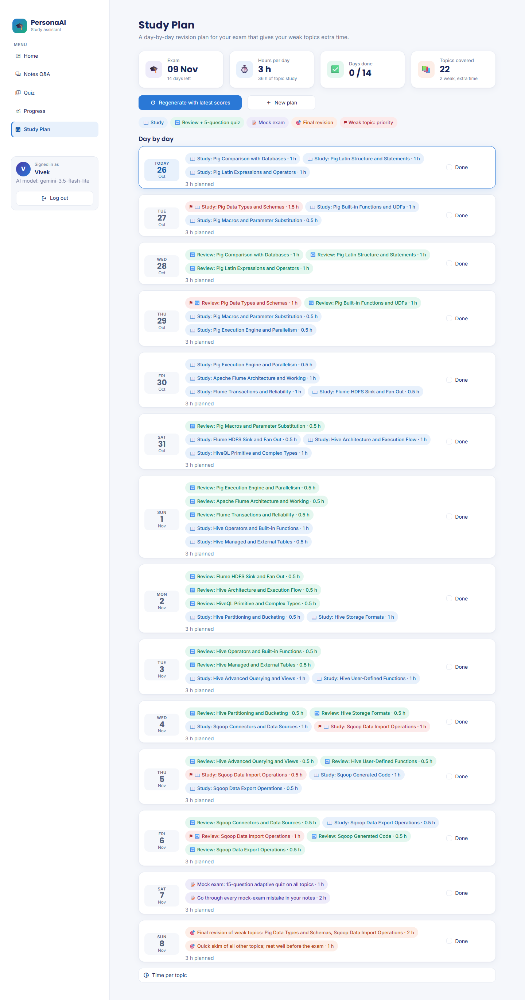

A full **14-day timetable**, 3 hours per day:

- Header cards: exam date and days left, hours per day, days completed, topics covered (*22, 2 weak with extra time*).
- Colour legend: 📖 Study · 🔁 Review + 5-question quiz · 📝 Mock exam · 🎯 Final revision · ⚑ **Weak topic: priority** (red).
- Each day lists its tasks with durations. Weak topics such as *Pig Data Types and Schemas · 1.5 h* are flagged in red.
- Today is highlighted, and each day has a **Done** checkbox to track completion.
- **7 Nov:** a 15-question mock exam. **8 Nov:** *Final revision of weak topics: Pig Data Types and Schemas, Sqoop Data Import Operations*.

### 27. Time per topic

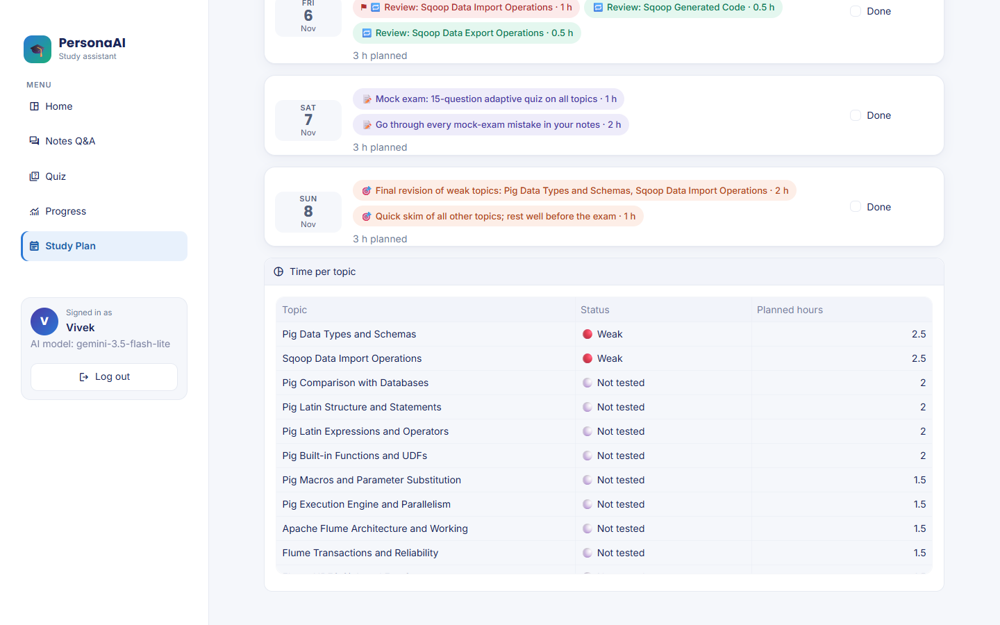

The **Time per topic** table shows how the hours were divided. The two **weak** topics get **2.5 h** each, not-tested topics 1.5–2 h, and strong topics the minimum. This is the weak-topic memory directly shaping the plan.

---

## 7. The adaptive loop in action

This section shows the full loop: **memory → adaptive quiz → improvement → memory updates → plan updates**.

### 28. An adaptive quiz

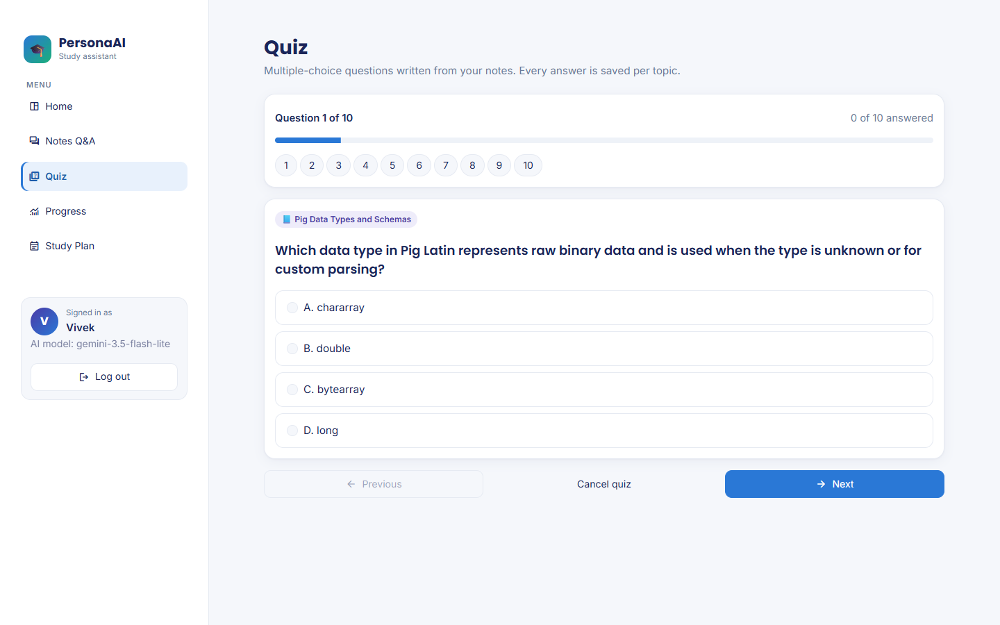

Vivek now chooses **Adaptive** mode (10 questions). The Adaptive focus card listed *Pig Data Types · 0%* and *Sqoop Data Import · 25%*, and the generated quiz confirms it: **6 of the 10 questions are on those two weak topics** (3 Pig, 3 Sqoop), and the other 4 cover the rest. That is the ~60% weak-topic share in action.

### 29. Results of the adaptive quiz

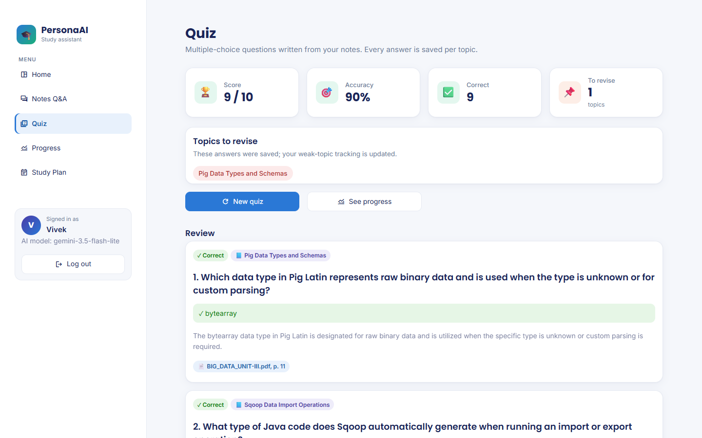

Having revised, Vivek scores **9/10 (90%)**. All the Sqoop questions are now correct; only one Pig question is wrong, so *Pig Data Types and Schemas* is the only topic left to revise.

### 30. Progress shows the improvement

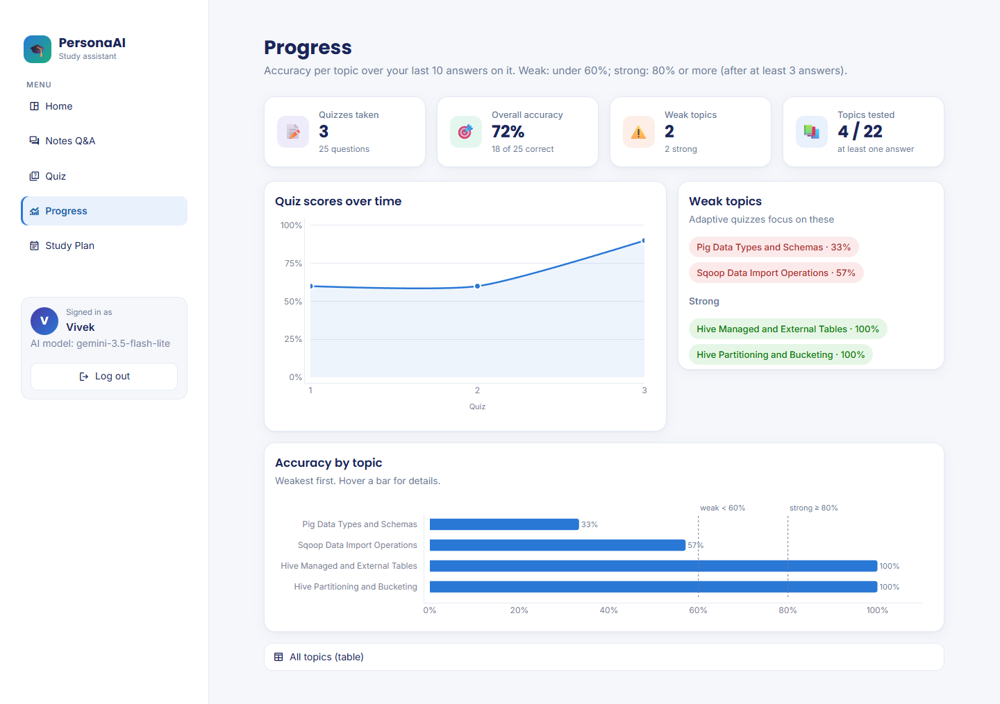

The **Quiz scores over time** line rises (60% → 60% → 90%). Topic accuracy updates: Pig 0% → **33%**, Sqoop 25% → **57%**. Both are still under 60%, so both are still weak. The system needs consistent evidence before it changes a label.

### 31. Another adaptive quiz

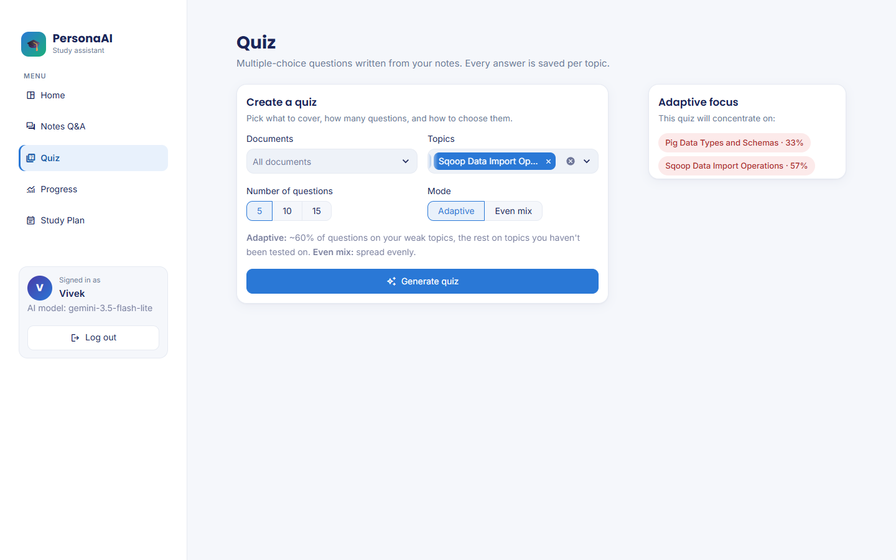

The **Adaptive focus** card now shows the updated percentages (*Pig 33%, Sqoop 57%*) and generates a 5-question adaptive quiz.

### 32. Perfect score

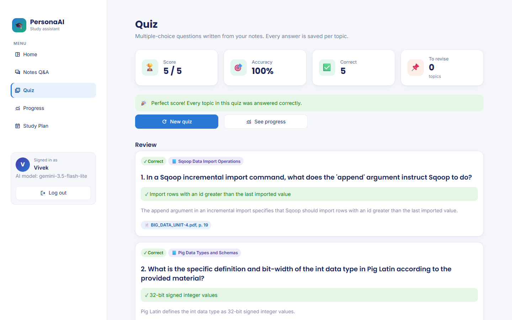

**5/5, 100%**, with the message *"Perfect score! Every topic in this quiz was answered correctly."*

### 33. Progress after four quizzes

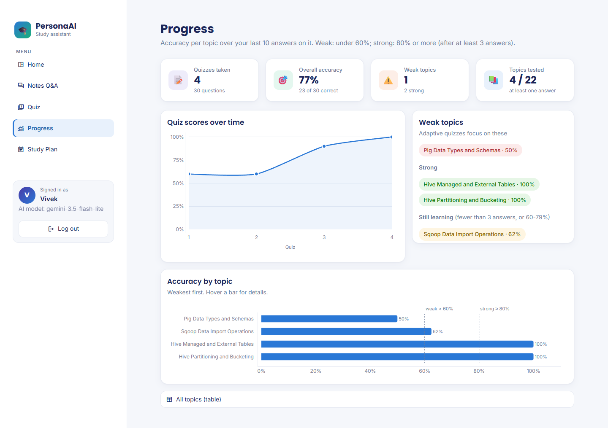

The memory has updated:

- **Score trend:** 60% → 60% → 90% → **100%**.
- **Sqoop Data Import Operations** rose to **62%** and moved from *Weak* to **Still learning** (yellow).
- **Pig Data Types and Schemas** is at **50%**, still weak, so it keeps getting attention.
- Overall accuracy: **77%** (23 of 30 correct). Weak topics: **1**.

### 34. Q&A knows about weak topics too

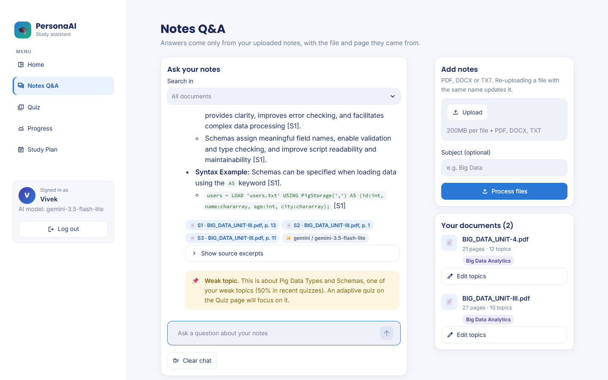

The memory is shared across features. When Vivek asks Notes Q&A *"Explain Pig data types and schemas"*, the cited answer is followed by a reminder: **"Weak topic. This is about Pig Data Types and Schemas, one of your weak topics (50% in recent quizzes). An adaptive quiz on the Quiz page will focus on it."**

### 35. Regenerating the study plan

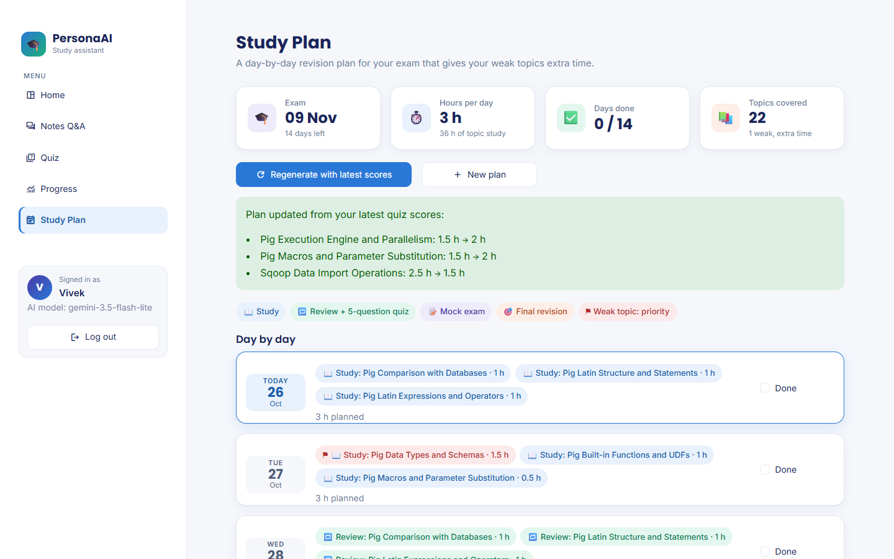

On the Study Plan page, **Regenerate with latest scores** rebuilds the plan from the current memory and **lists exactly what changed**:

- *Sqoop Data Import Operations: 2.5 h → 1.5 h* (no longer weak, so it needs less time);
- the freed time goes to other topics (*Pig Execution Engine and Parallelism 1.5 h → 2 h, Pig Macros and Parameter Substitution 1.5 h → 2 h*).

The header now reads *22 topics, 1 weak, extra time*. **The plan adapts to the student's performance**, which a static timetable cannot do.

### 36. Home dashboard at the end of the demo

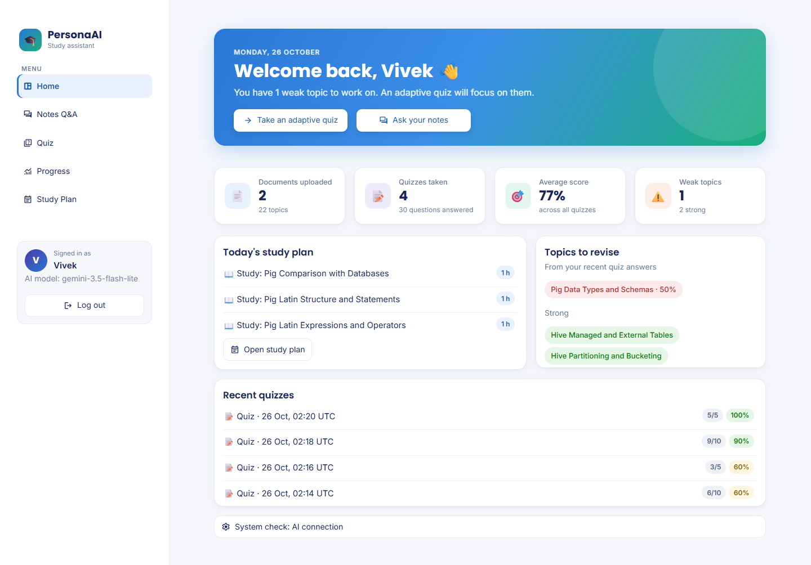

The dashboard summarises the journey: *"You have 1 weak topic to work on"*, 4 quizzes / 30 questions, **77% average**, today's study tasks pulled from the plan, the one remaining weak topic (*Pig Data Types and Schemas · 50%*), two strong topics, and the quiz history (60% → 60% → 90% → 100%).

---

## 8. System check

### 37. AI connection test

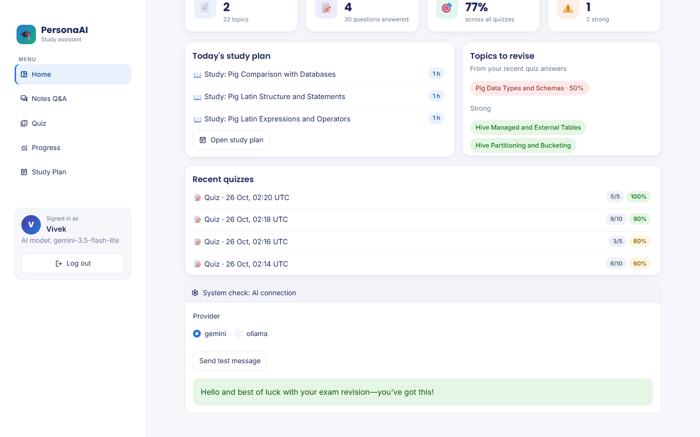

At the bottom of Home, **System check: AI connection** sends a test message to the selected provider:

- **Gemini** (Google, online), the default;
- **Ollama** (`llama3.1:8b`, runs fully offline on the laptop).

If the main Gemini model is busy or out of quota, PersonaAI automatically **falls back** to a lighter Gemini model, then to the local Ollama model. During this demo the main model (`gemini-3.8-flash`) was overloaded (HTTP 503/504 errors), and the app kept working because of this fallback chain. For the screenshots the lighter model was set as primary so pages loaded quickly, which is why the sidebar shows `gemini-3.5-flash-lite`.

---

## 9. Evaluation results

The project includes a formal evaluation (full details in [`evaluation/REPORT.md`](../../evaluation/REPORT.md)).

### 38. RAG vs plain LLM on real exam questions

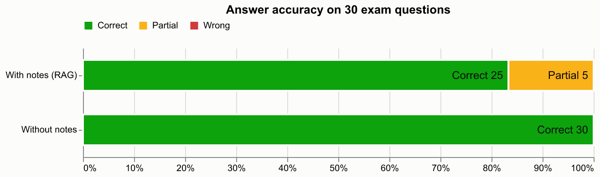

60 short exam questions from the course's question bank were answered **with notes (RAG)** and **without notes (plain LLM)**, then graded blindly by an LLM judge against model answers.

| Set | With notes (RAG) | Without notes |
|---|---|---|
| All 60 questions | **85%** correct | **98%** correct |

This is an honest result. The plain LLM scored higher **on these questions** because they are textbook definitions ("What is Hive?") the model already knows. But:

- **RAG gave 0 factually wrong answers.** Its 3 "wrong" verdicts were all *"not found in your notes"*.
- RAG's misses are **retrieval misses** (chunks that lose their section heading), with clear fixes listed as future work.
- RAG answers come **with file and page citations** and follow the course's own wording, which the plain LLM cannot do.

### 39. Adaptive vs even quizzes (simulation)

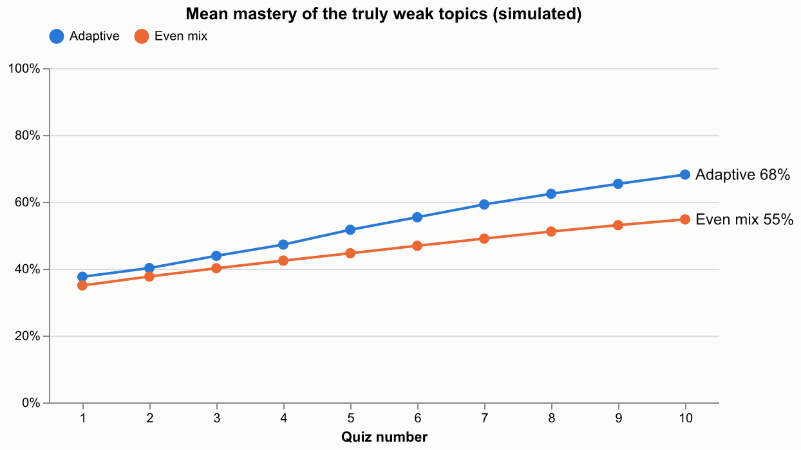

The app's real quiz-allocation and weak-topic code was run for 200 simulated students per mode (10 quizzes each, 5 of 20 topics truly weak):

| Measure | Adaptive | Even mix |
|---|---|---|
| Questions on the truly weak topics (quizzes 4–10) | **55%** | 25% |
| Mean mastery of weak topics after 10 quizzes (start ≈ 35%) | **68%** | 55% |

Adaptive mode spends **more than twice as much practice on weak topics**, and under the simulation's learning assumption ends about **13 points higher** in weak-topic mastery. (It is a simulation, not a study with real students; this is stated in the report.)

---

## 10. Architecture and tech stack

```
Upload PDF/DOCX/TXT
        │
        ▼
 Text extraction → Chunking → Embeddings → ChromaDB
                                              │
 Student question ──► Retrieve 20 chunks ◄────┘
                            │
                            ▼
                   Rerank (cross-encoder) → top 5
                            │
                            ▼
                   LLM (Gemini / Ollama) ──► Answer + citations

 Quiz answers ──► SQLite (topic scores) ──► Weak-topic memory
                                                  │
                                                  ▼
                                   Quiz targeting + Study plan
```

| Component | Technology |
|---|---|
| Language | Python 3.12 |
| Web UI | Streamlit (custom theme and styles) |
| Charts | Plotly |
| LLM | Google Gemini API (online), Ollama `llama3.1:8b` (offline fallback) |
| Embeddings | sentence-transformers `all-MiniLM-L6-v2` (local) |
| Reranking | cross-encoder `ms-marco-MiniLM-L-6-v2` (local) |
| Vector database | ChromaDB |
| App database | SQLite: users, documents, topics, quiz attempts and answers, topic scores, study plans |
| Document parsing | pypdf, python-docx |
| Testing | pytest: 101 tests |

**Code layout**

| Folder | Purpose |
|---|---|
| `app.py` | Entry point: sign-in and page routing |
| `views/` | One file per page: `home`, `notes_qa`, `quiz`, `progress`, `study_plan` |
| `core/` | Logic: `ingest`, `documents`, `vectorstore`, `rag`, `llm`, `quiz`, `memory`, `planner`, `db`, `charts`, `config` |
| `ui/` | Shared layout: sidebar shell and styles |
| `evaluation/` | RAG vs no-RAG evaluation and adaptive-quiz simulation |
| `tests/` | Automated tests |

---

## 11. Known limitations and future work

- **No password login:** a username identifies the student. Real deployment needs authentication.
- **Retrieval:** chunks can lose their section heading, causing some "not found" answers (see Evaluation). Fix: add section headings to chunks and split on section boundaries.
- **Weak-topic hint in Q&A** only appears when the question closely matches the topic name (e.g. *"Explain Pig data types and schemas"* triggers it; *"What are the data types in Pig Latin?"* does not). The matching threshold could be tuned.
- **Weak-topic detection needs 3+ answers per topic**, so the first one or two quizzes cannot yet adapt.
- **Adaptive benefit is shown by simulation**; a study with real students over several weeks would confirm it.
- **Deployment** to Streamlit Community Cloud is the next milestone.
