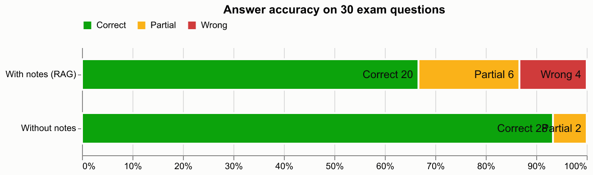

# Evaluation: answer accuracy with vs without the student's notes

- Questions: 30 (from `evaluation/questions.csv`)
- Notes indexed for RAG: BIG_DATA_UNIT-III.pdf, BIG_DATA_UNIT-4.pdf
- Answer model: claude / claude-sonnet-5-5; judge: claude / claude-sonnet-5-5 (blind, order randomised)
- Retrieval: embedding -> cross-encoder
- Manual overrides applied: 0

| Condition | Correct | Partial | Wrong | Accuracy | Score (partial = ½) |
|---|---|---|---|---|---|
| With notes (RAG) | 20 | 6 | 4 | 67% | 77% |
| Without notes | 28 | 2 | 0 | 93% | 97% |

RAG abstained ("not found in your notes") on 1 question(s); these count as wrong. When it did answer, 69% of its answers were correct.

## Per unit

| Unit | Questions | RAG accuracy | No-RAG accuracy |
|---|---|---|---|
| III | 15 | 60% | 93% |
| IV | 15 | 73% | 93% |

## Questions where the two conditions disagree

- Q5 *What is a Tuple in Pig?* — RAG: **wrong**, no-RAG: **correct**. It explicitly declines to define a tuple (no ordered set of fields, no mixed data types, no row analogy or example), only noting that a relation is a collection of tuples, so it fails to answer the question.
- Q6 *What is a Map in Pig?* — RAG: **wrong**, no-RAG: **correct**. It does not define a Map at all, only noting it is a complex type and saying the notes lack a definition, so none of the reference points (key-value pairs, string keys, mixed value types) are covered.
- Q7 *What are the benefits of using schemas?* — RAG: **correct**, no-RAG: **partial**. It gives a generic (non-Pig) discussion of schemas that touches on early detection of invalid data and documentation/readability, but it never mentions referencing fields by name instead of position and does not address Pig scripts or maintainability, so it misses key reference points.
- Q8 *What is the FILTER operator?* — RAG: **partial**, no-RAG: **correct**. Correctly says FILTER selects tuples based on a condition and gives a valid example, but never states that it removes non-matching records or that it is used to select data subsets.
- Q9 *What are GROUP and COGROUP operators?* — RAG: **partial**, no-RAG: **correct**. It correctly says GROUP/COGROUP organize tuples for aggregation and gives a GROUP example, but it never says GROUP organizes by a specified key or that COGROUP groups data from multiple relations, and it admits it cannot explain the difference.
- Q10 *What are UNION and SPLIT operators?* — RAG: **partial**, no-RAG: **correct**. It correctly says UNION combines and SPLIT divides datasets, but it omits that SPLIT uses conditions to route records and gives no example, explicitly noting the missing detail.
- Q12 *What is a Filter UDF?* — RAG: **partial**, no-RAG: **correct**. It captures the custom-condition filtering purpose and mentions AgeFilter, but never clearly states that the UDF returns a boolean accepting or rejecting a tuple, and its example is truncated without the age > 18 condition.
- Q17 *What is Schema-on-Read in Hive?* — RAG: **partial**, no-RAG: **correct**. It correctly defines schema-on-read as applying the schema when data is read, and mentions varied data types, but it does not explain that data need not follow a strict schema at storage, gives no example, and explicitly admits it lacks a fuller explanation.
- Q23 *What are conditional functions in Hive?* — RAG: **wrong**, no-RAG: **correct**. It declines to answer (NOT_FOUND) and does not explain that conditional functions return values based on a condition or mention IF() or CASE-WHEN, so it misses all main points of the reference.
- Q25 *Differentiate Managed and External Tables.* — RAG: **partial**, no-RAG: **correct**. It correctly covers who manages data/metadata and the drop behavior (with the employees/employee_ext example), but omits the third point that external tables are useful for sharing or preserving data independently.
- Q29 *What is a Subquery in Hive?* — RAG: **wrong**, no-RAG: **correct**. Abstained: answer not found in the notes.
- Q30 *What are Sqoop Connectors?* — RAG: **correct**, no-RAG: **partial**. Correctly explains connectors enabling communication with data stores, covers the JDBC connector and third-party connectors, but only implicitly mentions HDFS/Hive/HBase as endpoints rather than as connectors and frames custom connectors as vendor-provided rather than developer-built for specific sources.
