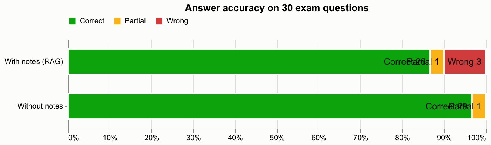

# Evaluation: answer accuracy with vs without the student's notes

- Questions: 30 (from `evaluation/questions.csv`)
- Notes indexed for RAG: BIG_DATA_UNIT-III.pdf, BIG_DATA_UNIT-4.pdf
- Answer model: gemini / gemini-3.5-flash-lite; judge: gemini / gemini-3.5-flash-lite (blind, order randomised)
- Retrieval: embedding -> cross-encoder
- Manual overrides applied: 0

| Condition | Correct | Partial | Wrong | Accuracy | Score (partial = ½) |
|---|---|---|---|---|---|
| With notes (RAG) | 26 | 1 | 3 | 87% | 88% |
| Without notes | 29 | 1 | 0 | 97% | 98% |

RAG abstained ("not found in your notes") on 3 question(s); these count as wrong. When it did answer, 96% of its answers were correct.

## Per unit

| Unit | Questions | RAG accuracy | No-RAG accuracy |
|---|---|---|---|
| III | 15 | 87% | 93% |
| IV | 15 | 87% | 100% |

## Questions where the two conditions disagree

- Q5 *What is a Tuple in Pig?* — RAG: **partial**, no-RAG: **correct**. It mentions that a tuple is a collection of fields similar to a table row, but it misses the explicit points about being an ordered set and having fields of different data types.
- Q6 *What is a Map in Pig?* — RAG: **wrong**, no-RAG: **correct**. Abstained: answer not found in the notes.
- Q7 *What are the benefits of using schemas?* — RAG: **correct**, no-RAG: **partial**. While it provides general database benefits like performance and optimization, it misses the specific Pig-related benefits mentioned in the reference answer such as referencing fields by name.
- Q23 *What are conditional functions in Hive?* — RAG: **wrong**, no-RAG: **correct**. Abstained: answer not found in the notes.
- Q29 *What is a Subquery in Hive?* — RAG: **wrong**, no-RAG: **correct**. Abstained: answer not found in the notes.
