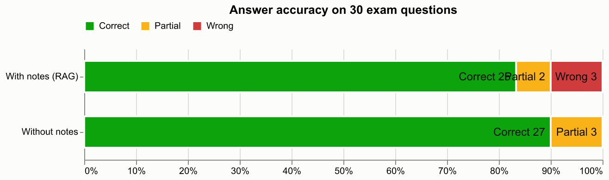

# Evaluation: answer accuracy with vs without the student's notes

- Questions: 30 (from `evaluation/questions.csv`)
- Notes indexed for RAG: BIG_DATA_UNIT-III.pdf, BIG_DATA_UNIT-4.pdf
- Answer model: gemini / gemini-3.5-flash-lite; judge: gemini / gemini-3.5-flash-lite (blind, order randomised)
- Retrieval: embedding+bm25 -> cross-encoder
- Manual overrides applied: 0

| Condition | Correct | Partial | Wrong | Accuracy | Score (partial = ½) |
|---|---|---|---|---|---|
| With notes (RAG) | 25 | 2 | 3 | 83% | 87% |
| Without notes | 27 | 3 | 0 | 90% | 95% |

RAG abstained ("not found in your notes") on 3 question(s); these count as wrong. When it did answer, 93% of its answers were correct.

## Per unit

| Unit | Questions | RAG accuracy | No-RAG accuracy |
|---|---|---|---|
| III | 15 | 87% | 93% |
| IV | 15 | 80% | 87% |

## Questions where the two conditions disagree

- Q5 *What is a Tuple in Pig?* — RAG: **partial**, no-RAG: **correct**. It mentions that a tuple is a collection of fields and compares relations to tables, but omits key details like the ordered nature of fields and does not provide an example.
- Q6 *What is a Map in Pig?* — RAG: **wrong**, no-RAG: **correct**. Abstained: answer not found in the notes.
- Q7 *What are the benefits of using schemas?* — RAG: **correct**, no-RAG: **partial**. While it mentions maintainability and type-mismatch error prevention, it focuses heavily on general big data query optimization and storage formats rather than the specific Pig-related benefits in the reference answer.
- Q17 *What is Schema-on-Read in Hive?* — RAG: **partial**, no-RAG: **correct**. It correctly identifies that the schema is applied when read, but misses the example and some of the broader context about handling varied datasets.
- Q20 *What are complex data types in Hive?* — RAG: **correct**, no-RAG: **partial**. It explains STRUCT, MAP, and ARRAY well and provides good examples, but completely omits UNIONTYPE which is part of the reference answer.
- Q23 *What are conditional functions in Hive?* — RAG: **wrong**, no-RAG: **correct**. Abstained: answer not found in the notes.
- Q26 *What is the difference between static and dynamic partitioning?* — RAG: **correct**, no-RAG: **partial**. While it describes general partitioning concepts and Hive dynamic partitioning, its definition of static partitioning leans more toward general resource/cluster partitioning rather than Hive-specific data insertion partitioning.
- Q29 *What is a Subquery in Hive?* — RAG: **wrong**, no-RAG: **correct**. Abstained: answer not found in the notes.
