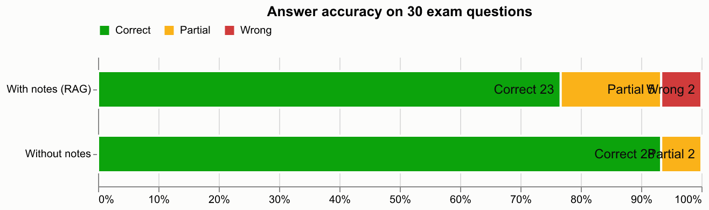

# Evaluation: answer accuracy with vs without the student's notes

- Questions: 30 (from `evaluation/questions.csv`)
- Notes indexed for RAG: BIG_DATA_UNIT-III.pdf, BIG_DATA_UNIT-4.pdf
- Answer model: claude / claude-sonnet-5-5; judge: claude / claude-sonnet-5-5 (blind, order randomised)
- Retrieval: embedding -> cross-encoder
- Manual overrides applied: 0

| Condition | Correct | Partial | Wrong | Accuracy | Score (partial = ½) |
|---|---|---|---|---|---|
| With notes (RAG) | 23 | 5 | 2 | 77% | 85% |
| Without notes | 28 | 2 | 0 | 93% | 97% |

RAG abstained ("not found in your notes") on 0 question(s); these count as wrong. When it did answer, 77% of its answers were correct.

## Per unit

| Unit | Questions | RAG accuracy | No-RAG accuracy |
|---|---|---|---|
| III | 15 | 87% | 93% |
| IV | 15 | 67% | 93% |

## Questions where the two conditions disagree

- Q35 *What is a Bag in Pig?* — RAG: **wrong**, no-RAG: **correct**. Does not define a bag as a collection of tuples or give any example, explicitly stating the notes don't cover what a bag contains, so it misses the main points.
- Q39 *What is the JOIN operator in Pig?* — RAG: **partial**, no-RAG: **correct**. It says JOIN combines tuples from multiple relations and mentions keys/conditions, but doesn't clearly state the common-key matching or give an example, and admits missing details.
- Q41 *What are User-Defined Functions (UDFs) in Pig?* — RAG: **correct**, no-RAG: **partial**. Correctly covers custom logic and the case when built-ins are insufficient, and mentions reuse, but does not mention modularity or the invalid-email filtering example, though its own example is valid.
- Q46 *What is HiveQL?* — RAG: **correct**, no-RAG: **partial**. Correctly identifies HiveQL as SQL-like and its translation to MapReduce/Tez/Spark, but only mentions DDL and DML (omitting DQL, TCL, and subqueries), so it covers the second reference point incompletely.
- Q50 *What are relational operators in Hive?* — RAG: **partial**, no-RAG: **correct**. It correctly defines relational operators as comparison operators and lists =, != and <, but omits >, <=, >= and LIKE, RLIKE, IN, BETWEEN, IS NULL and IS NOT NULL, and gives no WHERE-clause example.
- Q52 *What are mathematical functions in Hive?* — RAG: **partial**, no-RAG: **correct**. Lists all the reference functions (ROUND, FLOOR, CEIL, ABS, SQRT, RAND) with the SQRT(25) example and says they process numeric data, but it gives only a thin definition and explicitly notes that it offers no formal definition or detail.
- Q53 *What are UDFs in Hive?* — RAG: **partial**, no-RAG: **correct**. It correctly states UDF means User-Defined Function and that it adds custom logic, but it omits the UDF/UDAF/UDTF types (and the explode() example) and explicitly says the notes don't cover the types.
- Q56 *What is Bucketing in Hive?* — RAG: **partial**, no-RAG: **correct**. Correctly states bucketing divides a table/partition into a fixed number of files and improves join and sampling performance, but omits the CLUSTERED BY clause and the example, explicitly saying the syntax isn't covered.
- Q57 *How can data be imported into Hive?* — RAG: **wrong**, no-RAG: **correct**. It omits both main reference methods (LOAD DATA and INSERT INTO SELECT), covering only Sqoop and external tables, and admits it doesn't cover Hive's own loading commands.
